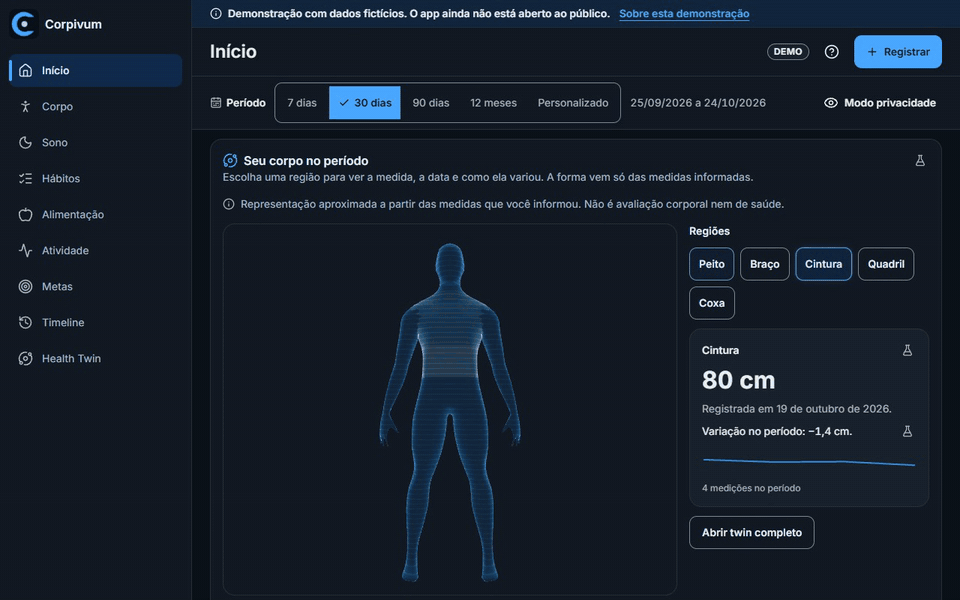
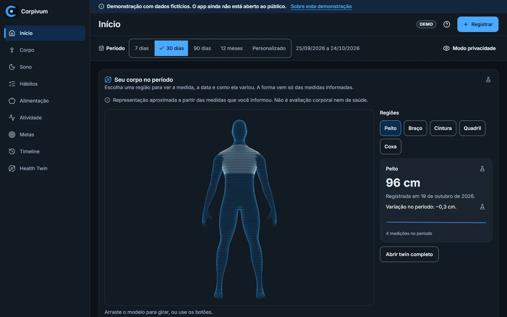
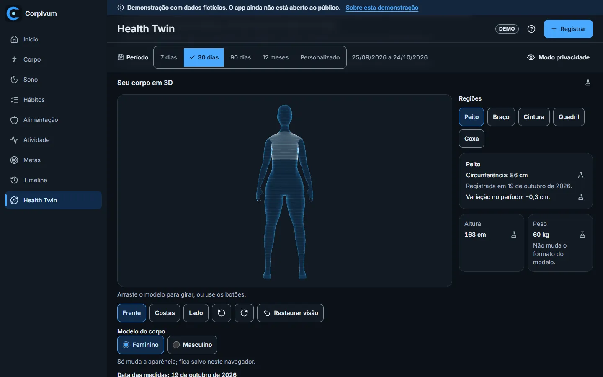
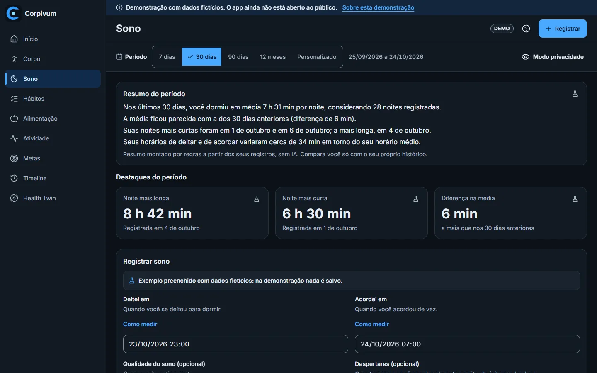
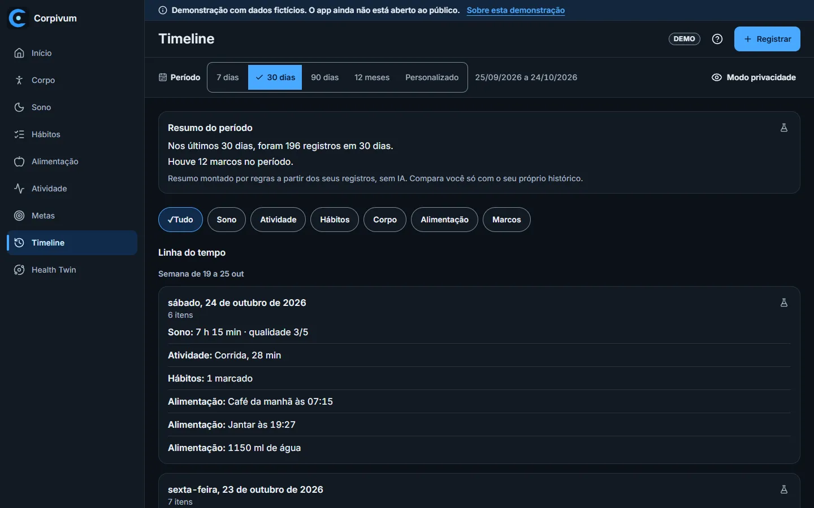
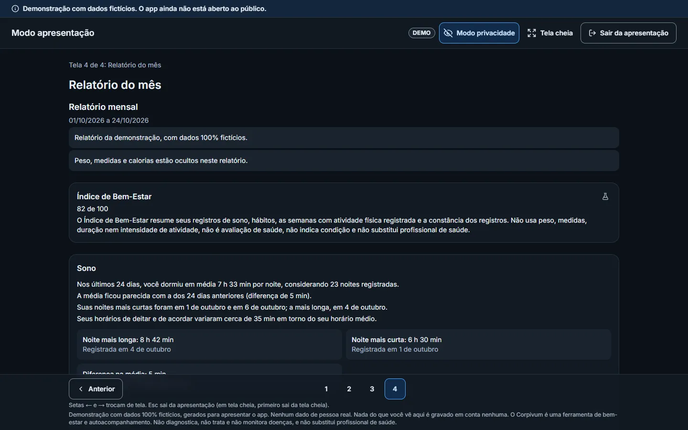
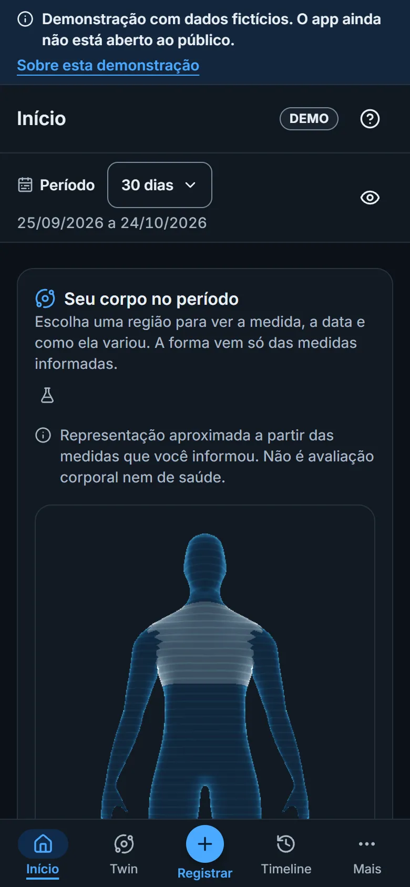
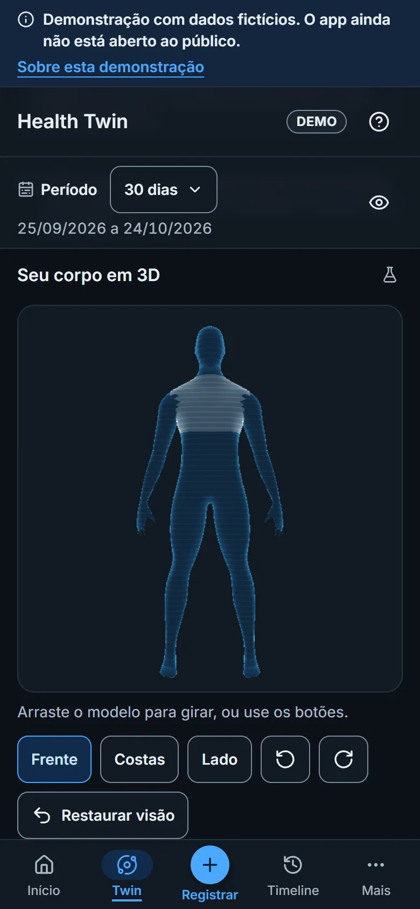
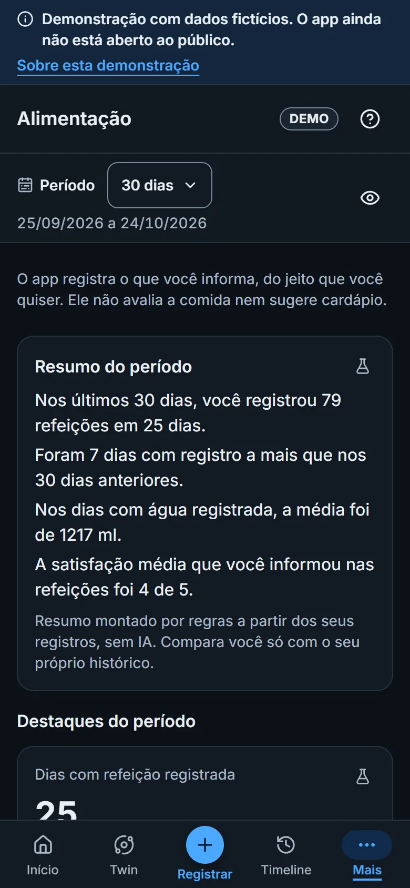
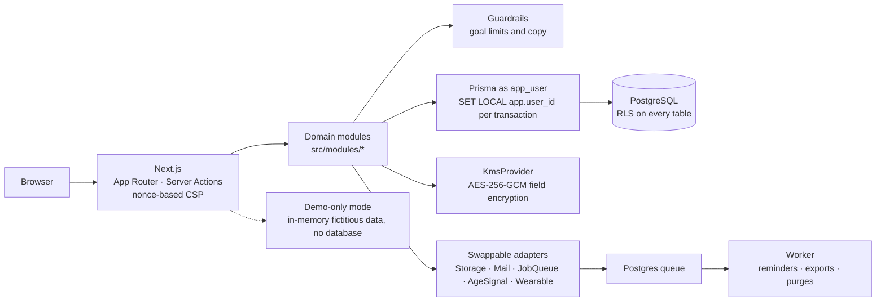

<p align="right"><a href="README.md">Português</a> · <b>English</b></p>

<h1 align="center">
  <br>
  Corpivum
</h1>

<p align="center">
  Personal tracking of your body and routine, with a 3D twin built only from your own measurements.<br>
  No AI, no ads, no trackers.
</p>

<p align="center">
  
  
  <a href="https://github.com/JH-2002/corpivum/actions/workflows/ci.yml"></a>
</p>

<p align="center">
  
</p>

> The app interface is in Brazilian Portuguese (pt-BR); the screenshots below show it as it ships.

## Highlights

- **Holographic 3D twin** calibrated by the measurements the person enters (height and circumferences), with
  comparison across dates.
- **Privacy by design**, built with Brazil's LGPD in mind: PostgreSQL Row-Level Security, field-level encryption
  and purpose-based consent.
- **No AI, no analytics:** summaries come from fixed rules; no ad SDKs or third-party trackers.
- **Accessibility tested with axe** in the end-to-end tests (WCAG 2.2 AA target), on screens from 320 to 1920 px.
- **Full CI:** lint, types, unit, database and e2e tests, SAST, secret scanning and a performance budget
  (dashboard interactive within 2.5 s on slow 4G).

## What the app does

A web app for adults (18+) in Brazil to keep track of their own body and routine:

- **Logging:** weight and body measurements, sleep, habits, meals and water, physical activity, goals and email
  reminders.
- **Making sense of the data:** charts by period, a timeline, rule-based written summaries and a Well-Being Index
  whose formula is shown on screen.
- **3D twin:** a body model built only from the entered measurements, by region and by date, with a non-WebGL
  fallback and support for reduced motion.
- **The person stays in control:** privacy mode (hides weight and measurements), presentation mode, full data
  export, correction, consent withdrawal and account deletion.
- **A label on every value shown:** MEASURED, REPORTED, ESTIMATED, INFERRED or DEMO.
- **Public demo** with a fictitious person, running without a database.

> **Not a medical device.** It is a wellness and self-tracking product: it does not diagnose, treat, prescribe
> diets or workouts, or replace a health professional. Goals beyond safety limits are blocked and the app points
> to professional help. See [`docs/INTENDED_USE.md`](docs/INTENDED_USE.md) (in Portuguese).

## Screenshots

All from the demo, with fictitious data.

| Home | 3D twin |
|---|---|
|  |  |
| **Sleep** | **Timeline** |
|  |  |
| **Presentation mode: report** | |
|  | |

<p align="center">
  
  
  
</p>

## Stack

| Layer | Technology |
|---|---|
| Web | Next.js 16 (App Router, Server Actions) · React 19 · TypeScript 6 (strict) · Tailwind CSS 4 |
| 3D and charts | React Three Fiber + three.js (no Drei, optimized `.glb` models) · Recharts |
| Data | PostgreSQL 17 · Prisma 7 · Zod 4 |
| Authentication | Custom: Argon2id, opaque database sessions, TOTP and recovery codes |
| i18n | next-intl (pt-BR) |
| Tests | Vitest · Testing Library · Playwright · axe-core |
| Tooling | pnpm · ESLint · Prettier · GitHub Actions · Semgrep · gitleaks · CodeQL · Dependabot |

## Architecture



- The app connects with a role that does not own the tables and has no `BYPASSRLS`; without the session's
  `app.user_id`, queries return zero rows. Migrations use a separate role.
- Pre-login flows (sign-up, sign-in, recovery) go through `SECURITY DEFINER` functions with a fixed
  `search_path` and minimal return values.
- Every external service sits behind an adapter with a local implementation, so providers can change without
  touching the domain.

## Privacy and security

- **Purpose-based consent:** no well-being data is processed without an active consent record; withdrawing it
  stops the processing.
- **Per-person isolation:** PostgreSQL Row-Level Security, checked in CI with cross-user isolation tests and
  queries without context.
- **Field-level encryption:** notes, meal descriptions and habit and exercise names are encrypted with a key per
  value (AES-256-GCM envelope bound to person, table and column); backups are encrypted too.
- **Custom authentication:** Argon2id, opaque session validated on every request, TOTP MFA and recovery codes,
  attempt lockout, constant-time secret comparison.
- **No AI, no analytics, no advertising:** no LLM provider, ad SDK or third-party tracker.
- **Metadata-only logs:** never the content of entries, notes or measurements; a test enforces it.
- **Data subject rights:** view and download all data, correct it, withdraw consent and delete the account with
  a purge.
- **Data in Brazil:** database, storage, queues and functions declared in a Brazilian region and checked in CI.
- **Under-18s** cannot create an account and no data about them is stored.

> The legal texts (terms, privacy policy) are drafts and have not been reviewed by a lawyer yet. The project
> makes no claim of legal compliance.

## Quality

- **987** unit tests (Vitest, 91 files), including a scan for forbidden health claims in the UI copy and color
  token contrast checks.
- **260** database tests against a real PostgreSQL: roles, RLS, authentication, MFA, logs without sensitive data
  and a backup-and-restore drill.
- **207** end-to-end tests with Playwright, split in two parallel shards, with axe in 14 of the 21 e2e test
  files; plus 2 isolated tests (minor and demo) and 10 for the database-free demo mode.
- **Performance:** dashboard interactive in 2.17–2.43 s on slow 4G with a 4× slower CPU (2.5 s budget), plus
  per-route JavaScript and 3D model size budgets.
- **Security in CI:** `pnpm audit`, Semgrep (OWASP Top 10), gitleaks over the git history, CodeQL and actions
  pinned by SHA.

<sub>CI numbers from 2026-10-24 · [`ci.yml` workflow](https://github.com/JH-2002/corpivum/actions/workflows/ci.yml)</sub>

## Decisions

Technical decisions are recorded as ADRs in [`docs/DECISIONS.md`](docs/DECISIONS.md) (in Portuguese). Some of
the main ones:

- **ADR-0014** — custom authentication instead of Auth.js (opaque session validated on every request).
- **ADR-0015** — RLS and `SECURITY DEFINER` functions for pre-login.
- **ADR-0016** — field encryption envelope format.
- **ADR-0026 / ADR-0028** — 3D body twin and holographic `.glb` models.
- **ADR-0030** — removal of the AI assistant and automatic recommendations.
- **ADR-0039** — performance budget, e2e and accessibility.
- **ADR-0043** — demo-only mode: ship just the demo, with no database or credentials.
- **ADR-0055** — motion and interactivity system, with a "reduce motion" option.

## How it was built

Developed with [Claude Code](https://claude.com/claude-code) (Anthropic). I defined the product, the legal
requirements (LGPD) and the technical decisions, and reviewed every step: plan, pull request, privacy review and
screenshots. Claude Code wrote the implementation.

## Running locally

The instructions below are only for evaluating the project, within the limits of the [LICENSE](LICENSE): the code
is open to read, no license to use it is granted and any other use requires permission. Requirements: Node 24 and
pnpm 12.

**Demo only** (no database or credentials):

```sh
pnpm install
DEMO_ONLY=true pnpm build
DEMO_ONLY=true APP_ENV=test APP_URL=http://localhost:3000 pnpm start
# open http://localhost:3000/demo
```

**Full app** (Docker for PostgreSQL and Mailpit): follow
[`docs/runbooks/LOCAL_DEV.md`](docs/runbooks/LOCAL_DEV.md) (in Portuguese). In short: `pnpm install`,
`cp .env.example .env` (with local passwords and keys), `pnpm db:up`, `pnpm db:migrate`, `pnpm dev`.

## Status and next steps

The first version's code is complete, but the app **has not launched yet**. Steps outside the code remain before
opening it to the public:

- legal review of the texts, and naming the controller and data protection officer;
- review by health professionals of the copy, the goal safety limits and the 3D model;
- choosing and contracting hosting in Brazil, wiring the providers and testing a restore;
- an independent penetration test and a manual screen reader test;
- a closed beta with a few people.

Details in [`docs/ESTADO_DO_PROJETO.md`](docs/ESTADO_DO_PROJETO.md) (in Portuguese).

## License

All rights reserved. The repository is public for viewing only, as a portfolio; no license to use it is
granted. See [`LICENSE`](LICENSE) and, for third-party components,
[`THIRD_PARTY_NOTICES.md`](THIRD_PARTY_NOTICES.md).

## Author

**João Henrique Arruda do Carmo** · [github.com/JH-2002](https://github.com/JH-2002)
