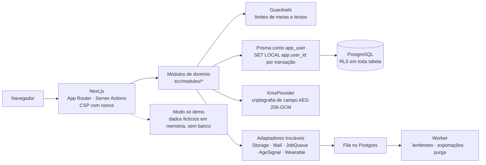

<p align="right"><b>Português</b> · <a href="README.en.md">English</a></p>

<h1 align="center">
  <br>
  Corpivum
</h1>

<p align="center">
  Acompanhamento pessoal do corpo e da rotina, com twin 3D feito só com as suas medidas.<br>
  Sem IA, sem anúncios, sem rastreadores.
</p>

<p align="center">
  
  
  <a href="https://github.com/JH-2002/corpivum/actions/workflows/ci.yml"></a>
</p>

<p align="center">
  
</p>

## Destaques

- **Twin 3D holográfico** calibrado pelas medidas que a pessoa informa (altura e circunferências), com
  comparação entre datas.
- **Privacidade por design**, pensada para a LGPD: Row-Level Security no PostgreSQL, criptografia de campo e
  consentimento por finalidade.
- **Sem IA e sem analytics:** resumos montados por regras fixas, nenhum SDK de publicidade ou rastreador.
- **Acessibilidade testada com axe** nos testes de ponta a ponta (meta WCAG 2.2 AA), em telas de 320 a 1920 px.
- **CI completa:** lint, tipos, testes unitários, de banco e e2e, SAST, varredura de segredos e orçamento de
  desempenho (painel interativo em até 2,5 s com 4G lenta).

## O que o app faz

Um app web para adultos (18+) no Brasil acompanharem o próprio corpo e a própria rotina, em pt-BR:

- **Registros:** peso e medidas, sono, hábitos, alimentação e água, atividade física, metas e lembretes por e-mail.
- **Leitura dos dados:** gráficos por período, linha do tempo, resumos escritos por regras e um Índice de
  Bem-Estar com a regra de cálculo aberta na tela.
- **Twin 3D:** modelo do corpo feito só com as medidas informadas, por região e por data, com alternativa sem
  WebGL e respeito a "reduzir movimento".
- **Controle da pessoa:** modo privacidade (esconde peso e medidas), modo apresentação, exportação completa dos
  dados, correção, revogação de consentimento e exclusão da conta.
- **Selo em todo dado exibido:** MEDIDO, INFORMADO, ESTIMADO, INFERIDO ou DEMO.
- **Demonstração pública** com uma pessoa fictícia, que roda sem banco de dados.

> **Não é dispositivo médico.** É um produto de bem-estar e autoacompanhamento: não diagnostica, não trata, não
> prescreve dieta nem treino e não substitui profissional de saúde. Metas fora de limites de segurança são
> bloqueadas, com indicação de ajuda profissional. Ver [`docs/INTENDED_USE.md`](docs/INTENDED_USE.md).

## Capturas

Todas da demonstração, com dados fictícios.

| Início | Twin 3D |
|---|---|
|  |  |
| **Sono** | **Linha do tempo** |
|  |  |
| **Modo apresentação: relatório** | |
|  | |

<p align="center">
  
  
  
</p>

## Stack

| Camada | Tecnologia |
|---|---|
| Web | Next.js 16 (App Router, Server Actions) · React 19 · TypeScript 6 (strict) · Tailwind CSS 4 |
| 3D e gráficos | React Three Fiber + three.js (sem Drei, modelos `.glb` otimizados) · Recharts |
| Dados | PostgreSQL 17 · Prisma 7 · Zod 4 |
| Autenticação | Própria: Argon2id, sessão opaca em tabela, TOTP e códigos de recuperação |
| i18n | next-intl (pt-BR) |
| Testes | Vitest · Testing Library · Playwright · axe-core |
| Ferramentas | pnpm · ESLint · Prettier · GitHub Actions · Semgrep · gitleaks · CodeQL · Dependabot |

## Arquitetura



- A aplicação conecta com um papel sem privilégio de dono e sem `BYPASSRLS`; sem o `app.user_id` da sessão, as
  consultas retornam zero linhas. Migrações usam outro papel.
- O pré-login (cadastro, entrada, recuperação) passa por funções `SECURITY DEFINER` com `search_path` fixo e
  retorno mínimo.
- Cada serviço externo entra por um adaptador com implementação local, para trocar de fornecedor sem mexer no
  domínio.

## Privacidade e segurança

- **Consentimento por finalidade:** nenhum dado de bem-estar é tratado sem um registro de consentimento ativo;
  revogar interrompe o tratamento.
- **Isolamento por pessoa:** Row-Level Security no PostgreSQL, verificada na CI com testes de isolamento entre
  usuários e de consulta sem contexto.
- **Criptografia de campo:** notas, descrições de refeição e nomes de hábitos e exercícios são cifrados com uma
  chave por valor (envelope AES-256-GCM, contexto da pessoa, tabela e coluna); as cópias de segurança também.
- **Autenticação própria:** Argon2id, sessão opaca validada a cada requisição, MFA com TOTP e códigos de
  recuperação, bloqueio por tentativas, comparação de segredos em tempo constante.
- **Sem IA, sem analytics, sem publicidade:** nenhum provedor de LLM, SDK de anúncios ou rastreador de terceiros.
- **Logs só com metadados:** nunca o conteúdo de registros, notas ou medidas; há teste que garante isso.
- **Direitos do titular:** ver e baixar todos os dados, corrigir, revogar consentimentos e excluir a conta com
  purga.
- **Dados no Brasil:** banco, armazenamento, filas e funções declarados em região brasileira e conferidos na CI.
- **Menores de 18** não criam conta e não têm dado guardado.

> Os textos jurídicos (termos, política de privacidade) são rascunhos e a revisão jurídica ainda não foi feita.
> O projeto não afirma conformidade legal.

## Qualidade

- **987** testes unitários (Vitest, 91 arquivos), incluindo varredura de alegações proibidas nos textos da
  interface e contraste dos tokens de cor.
- **260** testes de banco com PostgreSQL real: papéis, RLS, autenticação, MFA, logs sem dado sensível e ensaio
  de backup e restauração.
- **207** testes de ponta a ponta com Playwright, em duas partes paralelas, com axe em 14 dos 21 arquivos de
  teste; mais 2 testes isolados (menor de idade e demo) e 10 do modo só demo sem banco.
- **Desempenho:** painel interativo entre 2,17 s e 2,43 s com 4G lenta e CPU 4× mais lenta (teto de 2,5 s), e
  tetos de JavaScript por rota e de tamanho dos modelos 3D.
- **Segurança na CI:** `pnpm audit`, Semgrep (OWASP Top 10), gitleaks no histórico, CodeQL e actions fixadas
  por SHA.

<sub>Números da CI de 24/10/2026 · [workflow `ci.yml`](https://github.com/JH-2002/corpivum/actions/workflows/ci.yml)</sub>

## Decisões

As decisões técnicas estão registradas como ADRs em [`docs/DECISIONS.md`](docs/DECISIONS.md). Algumas das
principais:

- **ADR-0014** — autenticação própria em vez do Auth.js (sessão opaca validada a cada requisição).
- **ADR-0015** — RLS e funções `SECURITY DEFINER` para o pré-login.
- **ADR-0016** — formato do envelope de criptografia de campo.
- **ADR-0026 / ADR-0028** — twin 3D do corpo e modelos `.glb` holográficos.
- **ADR-0030** — remoção do assistente de IA e das recomendações automáticas.
- **ADR-0039** — orçamento de desempenho, e2e e acessibilidade.
- **ADR-0043** — modo só demo: publicar apenas a demonstração, sem banco nem credenciais.
- **ADR-0055** — sistema de movimento e interatividade, com "reduzir animações".

## Como foi construído

Desenvolvido com o [Claude Code](https://claude.com/claude-code) (Anthropic). Eu defini o produto, os requisitos
legais (LGPD) e as decisões técnicas, e revisei cada etapa: plano, pull request, revisão de privacidade e
capturas de tela. O Claude Code implementou o código.

## Como rodar localmente

As instruções abaixo servem só para avaliar o projeto, nos limites da [LICENSE](LICENSE): o código está aberto
para leitura, nenhuma licença de uso é concedida e qualquer outro uso depende de autorização. Requisitos: Node 24 e
pnpm 12.

**Só a demonstração** (sem banco nem credenciais):

```sh
pnpm install
DEMO_ONLY=true pnpm build
DEMO_ONLY=true APP_ENV=test APP_URL=http://localhost:3000 pnpm start
# abra http://localhost:3000/demo
```

**App completo** (Docker para o PostgreSQL e o Mailpit): siga
[`docs/runbooks/LOCAL_DEV.md`](docs/runbooks/LOCAL_DEV.md). Em resumo: `pnpm install`, `cp .env.example .env`
(com senhas e chaves locais), `pnpm db:up`, `pnpm db:migrate`, `pnpm dev`.

## Status e próximos passos

O código da primeira versão está completo, mas o app **ainda não foi lançado**. Antes de abrir ao público
faltam etapas fora do código:

- revisão jurídica dos textos e definição do responsável legal e do encarregado de dados;
- revisão por profissionais de saúde dos textos, dos limites de segurança das metas e do modelo 3D;
- escolha e contratação da hospedagem no Brasil, ligação aos fornecedores e teste de restauração;
- teste de invasão independente e teste manual com leitor de tela;
- teste fechado com poucas pessoas.

Detalhes em [`docs/ESTADO_DO_PROJETO.md`](docs/ESTADO_DO_PROJETO.md).

## Licença

Todos os direitos reservados. O repositório é público só para visualização, como portfólio; nenhuma licença de
uso é concedida. Ver [`LICENSE`](LICENSE) e, para componentes de terceiros,
[`THIRD_PARTY_NOTICES.md`](THIRD_PARTY_NOTICES.md).

## Autor

**João Henrique Arruda do Carmo** · [github.com/JH-2002](https://github.com/JH-2002)
